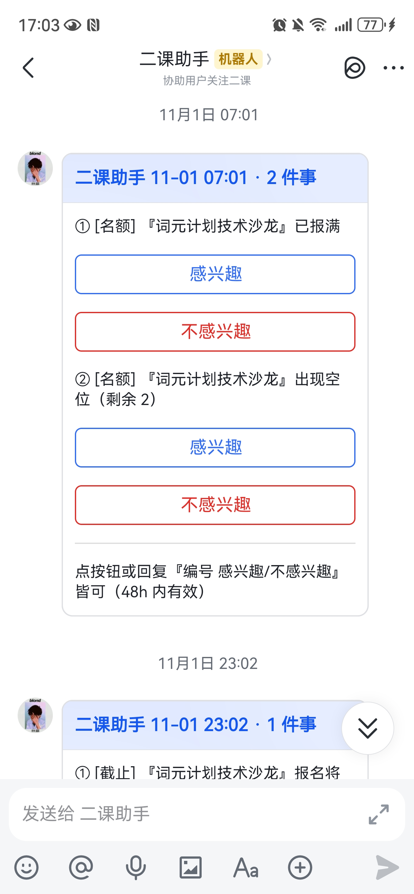

# erke-assistant · 二课助手

给中国科学技术大学（USTC）「第二课堂」平台写的个人巡检助理：每小时替你看一眼平台上的活动，把值得关注的动态合并成一条消息，在固定时间推到你的飞书。

产品定位：这是一件个人工具，不是通用产品——它只用你本人的登录凭据访问你本人可见的数据，把结果推给你自己；没有用户系统、没有数据库、没有网页界面。

## 效果预览

一次真实推送的样子：巡检发现关注的活动先「已报满」、几小时后「出现空位」，两件事合并成一条飞书消息卡片；每件动向自带「感兴趣 / 不感兴趣」按钮，点按钮或回复编号即可反馈（48 小时内有效），反馈会喂给偏好学习：

<p align="center">
  
</p>

## 它做什么

- **每小时巡检**：「报名中」活动列表 + 你关注的系列活动的全部子场次
- **两级推荐**：主题词命中必推；其余活动交给 LLM 按你的偏好档案打 1~10 分，过线才推
- **七类动向监控**（只盯你关注的活动）：名额变化、报名截止、时间地点调整、状态变化、开始前提醒、内容变更、系列新场次
- **合并推送**：每天 12 点、23 点两个固定时点 + 当天第一波有内容的巡检（即早上若有积压内容会推送）；每日条数有预算，装不下的整条顺延下轮，事件永不丢
- **双向反馈**：推送是带按钮的飞书消息卡片——点按钮或回复编号就能表达"感兴趣/不感兴趣"；LLM 据此每天至多自动微调一次你的偏好档案（幅度有上限、超限申请整单作废、随时可撤销回滚）

## 架构一图

```
      定时器（任务计划程序 / cron，每小时）          feedback_server.py（常驻进程）
                  │                                飞书长连接（WebSocket）收你的回复
             agent.py                              │ 解析后落盘 state/feedback.json
      命令行入口：参数解析、配置加载                 （下轮巡检消费）
                  │
             patrol.py  一次巡检的编排
  ┌─────────────┬────────────────┬────────────┬─────────────┐
source/         core/            store.py     output/
platform.py     领域逻辑：打分/    状态落盘：    推送通道：
平台 API 客户端  动向/调档/        state/*.json 飞书消息卡片
（离线模式读     预算/关注         原子写+      （未配置密钥自动
 tests/ 假数据） （零运输依赖）     互斥锁       降级为终端打印）
```

偏好与主题词是两个文本文件（`preferences.md` / `themes.txt`），可以由使用者自由修改，状态全在 `state/` 下的 JSON 文件——没有数据库、没有进程内隐状态，出问题先看 `logs/agent.log`（决策日志写清"为什么没推"）。

## 决策亮点

- **安全自动化**：真实巡检持互斥锁防撞车；抓取有总时长限制；接口计数异常直接拒绝抓取；网络失败退避重试，推送失败的事件回待发队列，绝不丢弃；状态原子落盘（tmp + rename）；一切可调参数集中在 `config.toml` 并做范围校验。
- **受限 LLM**：LLM 只干两件事——语义打分和受护栏约束的偏好调档。响应解析层层容错（坏 JSON 逐对象抢救、分数钳制、幻觉活动 id 丢弃）；它不做自由决策，调档有窗口、幅度、校验多重闸门，应用前自动快照、可一键回滚。
- **通道隔离**：所有推送细节隔离在 `output/` 一个包里，领域层不碰网络与推送；飞书自建应用走官方长连接接收事件（免域名、免证书、免公网 IP）；密钥都不配时自动降级为"仅打印"——离线演练零配置可跑。
- **离线优先**：`--offline` 模式读随码附带的假数据（含系列子项目场景），状态写进独立沙箱目录，不碰网络、不碰真实状态——调试即验证。

## 5 分钟离线试跑

不注册任何平台、不需要任何密钥：

```
git clone https://github.com/<你的用户名>/erke-assistant.git
cd erke-assistant
pip install -r requirements.txt      # 需要 Python 3.11+
copy config.example.toml config.toml # Windows（macOS/Linux 用 cp）
```

再把 `tests/offline_sample.json` 里的 `"_anchor"` 改成当前时间（如 `"2026-11-05 20:30"`）——演示场景的时间都以它为锚，不改的话场景已成过去、推不出东西。然后：

```
python agent.py --offline            # 第 1 次：静默建活动基线
python agent.py --offline            # 第 2 次：参加提醒、报名截止提醒打印到终端
```

- `--offline` 读 `tests/offline_sample.json` 假数据，状态写进 `state-offline/` 沙箱，真实的 `state/` 不受影响。
- 未配置推送密钥时，汇总自动降级为终端打印，你会看到 `【未配置推送通道，仅打印】` 开头的卡片；照上面顺序跑，第 2 次就能看到一条即时的"参加提醒"和一张汇总卡。
- 想再看一遍演示：把 `"_anchor"` 改成新的当前时间、删掉 `state-offline/` 目录，再连跑两遍（推送过的事件只发一次，不清状态不会重推）。

## 接入真实数据

1. **平台凭据**：环境变量 `ERKE_PLATFORM_TOKEN` = 浏览器登录第二课堂后，从开发者工具请求头里复制的 `X-Access-Token`。凭据失效时系统会推送"该换票了"告警，更新环境变量即可，下次巡检自动恢复。
2. **偏好**：复制 `preferences.example.md` 为 `preferences.md` 照注释填写（LLM 打分的唯一依据，越具体越准）；复制 `themes.example.txt` 为 `themes.txt` 写"绝对不想错过"的主题词（命中必推）。
3. **配置**：复制 `config.example.toml` 为 `config.toml`，按注释调整。
4. **定时**：用任务计划程序（Windows）或 cron 每小时跑一次 `python agent.py`；若要接收飞书回复反馈，再常驻运行 `python feedback_server.py`（不跑它只是收不到你的回复，推送照常）。

## 飞书自建应用创建流程

在[飞书开放平台](https://open.feishu.cn)上：

1. 创建「企业自建应用」，在「应用功能」里开通**机器人**能力；
2. 「权限管理」里开通：机器人发消息（`im:message:send_as_bot`）+ 读取用户发给机器人的单聊消息（`im:message.p2p_msg:readonly`）；
3. 把 App ID / App Secret（「凭证与基础信息 > 应用凭证」页）配成环境变量 `ERKE_FEISHU_APP_ID` / `ERKE_FEISHU_APP_SECRET`（见下表），然后本机跑起 `python feedback_server.py`（默认占 80 端口，被占用时设 `PORT` 环境变量换一个）；
4. 「事件与回调 > 事件配置」里把订阅方式改为**「使用长连接接收事件」**并保存——控制台要求长连接客户端在线，所以上一步要先把 `feedback_server.py` 跑起来。长连接免域名、免证书、免公网，卡片按钮回调同样走这条通道；
5. 在同一页面添加事件「接收消息 `im.message.receive_v1`」和回调「卡片回传交互 `card.action.trigger`」；
6. 「版本管理与发布」里创建版本并发布，**可用范围要包含你自己**（权限与事件发布后才生效）；
7. **首次授权**：在飞书里找到这个机器人，随便发一条消息——接收者 open_id 自动发现并缓存；也可以在 `config.toml` 的 `[feishu] open_id` 里直接固定。

## 环境变量表

| 环境变量 | 必填？ | 用途 |
|---|---|---|
| `ERKE_PLATFORM_TOKEN` | 真实巡检必填 | 第二课堂登录凭据（浏览器请求头 `X-Access-Token`） |
| `ERKE_LLM_API_KEY` | 推荐 | OpenAI 兼容端点的 API Key（LLM 打分/调档用；不配则推荐停摆，动向监控照常） |
| `ERKE_FEISHU_APP_ID` | 可选 | 飞书自建应用凭证，与下一个变量两个齐备 = 飞书推送启用 |
| `ERKE_FEISHU_APP_SECRET` | 可选 | 同上 |
| `ERKE_FEISHU_VERIFY_TOKEN` | 可选 | 仅公网 HTTP 回调备用路径需要；长连接模式下不需要 |

## 边界声明

- **仅本人账号数据**：只用配置者本人的登录凭据访问其本人可见的数据，不实现也不提供访问他人数据的任何途径。
- **遵守平台规则**：巡检频率小时级；接口响应异常（计数超限）直接拒绝抓取；遇验证码/风控立即停止并告警，绝不绕过。
- **仅供学习**：为作者的个人场景而写，无兼容性与可用性承诺；接入平台请遵守所在学校的相关规定。
- **按 MIT 许可证发布**，详见 [LICENSE](LICENSE)。
